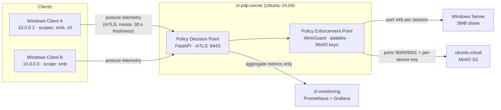

# Privacy-Preserving Telemetry for Continuous Verification in Zero Trust File Sharing

Laboratory implementation for my MSc thesis, *Design and Experimental Evaluation of Privacy-Preserving Telemetry for Continuous Verification in Zero Trust Enterprise File Sharing* (MSc Communication Engineering, FH Kärnten, 2026).

---

## What this is

A working Zero Trust lab, built to NIST SP 800-207, that keeps checking device posture before granting access to files, without the policy engine ever needing to see the raw device data.

Endpoints report their security posture every 60 seconds (disk encryption, patch age, failed logons, Secure Boot, network zone and so on). A Policy Decision Point scores that posture and issues ALLOW or DENY. A Policy Enforcement Point then opens or closes the network path and the credentials to two file-sharing planes: an on-premises **SMB** share and an **S3-compatible MinIO** object store. Trust expires on its own after 120 seconds unless it is renewed.

The research question is how much privacy can be added to that telemetry, and at what cost. The same trust algorithm runs in three modes:

| Mode | What the PDP sees | Technique |
|---|---|---|
| `baseline` | Raw posture claims | None (reference) |
| `hmac` | Pseudonymised claims | Salted HMAC with rotating salt, identifier guard |
| `he` | Encrypted sub-scores only | Paillier homomorphic encryption: the PDP computes `Enc(score − threshold)` and never sees the score |

`test_scoring_parity.py` checks 20,000 random postures plus the evaluation corner cases and asserts that all three modes give identical decisions, so the modes can be compared fairly.

## Architecture

Neither resource server runs any policy code. Whether a client can reach them is decided entirely on the network path, which shows that the approach works with existing file servers without modifying them.

## Repository layout

The code is organised by the virtual machine that runs it. Each folder has its own README explaining every file.

| Folder | Machine | What runs there |
|---|---|---|
| [`01_zt-pdp-server/`](01_zt-pdp-server/) | zt-pdp-server (Ubuntu 24.04) | PDP, PEP, trust algorithm, homomorphic engine, experiment runner, setup scripts |
| [`02_windows-client-a/`](02_windows-client-a/) | Windows Client A | PowerShell telemetry agent, client-side Paillier encryption |
| [`03_windows-client-b/`](03_windows-client-b/) | Windows Client B | Same code as Client A, different scope (micro-segmentation test) |
| [`04_windows-server-smb/`](04_windows-server-smb/) | Windows Server | No custom code, only configuration commands |
| [`05_ubuntu-cloud-minio/`](05_ubuntu-cloud-minio/) | ubuntu-cloud | MinIO setup and verification; earlier REST/WebDAV designs under `superseded/` |
| [`06_zt-monitoring/`](06_zt-monitoring/) | zt-monitoring | Prometheus scrape config, Grafana dashboard |

## One decision cycle

1. **Client** collects device posture, applies the privacy transform for its mode, and submits the report over mutual TLS.
2. **PDP** validates the schema, freshness and nonce, runs the trust algorithm (in `he` mode, over ciphertext), and decides ALLOW or DENY.
3. **PEP** admits or removes the WireGuard peer, installs or withdraws per-scope iptables rules, and mints or revokes a per-device MinIO key, all under a single lock.
4. **SMB share** and **object store** become reachable or unreachable as a result.

## Key design points

- **One source of truth for scoring.** The trust algorithm lives in `scoring.py`, which both the server and the clients use, so the modes cannot drift apart.
- **Fail-closed.** If the agent can't reach the PDP, it doesn't assume the previous ALLOW still holds. Access lapses when the session expires.
- **Defence in depth on S3.** Access is cut at the network layer and the credential is revoked too, so a client that somehow kept network access would still hold a dead key.
- **Privacy-preserving observability.** Prometheus only ever receives aggregate counters and latencies, with no per-device series, identifiers or scores.
- **Replay protection.** Every report carries a per-message nonce and has to arrive within a 30-second freshness window.

## Tech stack

Python (FastAPI, Uvicorn, Pydantic, `phe` Paillier) · PowerShell · WireGuard · iptables · OpenSSL PKI / mutual TLS · MinIO / S3 · Windows Server SMB · Prometheus · Grafana · systemd · Ubuntu 24.04 · Windows clients

## Note on scope

This is research lab code, written to evaluate the design under controlled conditions. It is not hardened for production use. IP addresses refer to the isolated lab network. Secrets are never stored in the repository: admin tokens come from environment variables, and the MinIO credential is generated at install time.

## License

[MIT](LICENSE) © 2026 Maria Lourdes Tonitz
